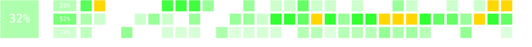

# My solutions to problems from Polish Olympiad in Informatics

## Structure

Repo contains four important parts:
* `rozwiazania/` - my c++ solutions for problems from Polish Olympiad in Informatics
* `checklista/` - checklist updater (from forked repo) 
* `template/` - useful scripts used in my competitive programming competitions
* `README.md` - shows checklist with detailed statistics for each editions, stage etc.

<!-- AUTO-CHECKLIST -->

> ⚠️ **NOTE:** The section below is generated automatically.
> Do not modify the README below this notice.
> ✅ means a completed task.
> 🤔 means a task with fewer than 100 points.

# Summary

## Solved tasks by stage

Stage I | Stage II | Stage III | Total
:---: | :---: | :---: | :---:
43/150 (29%) | 82/157 (52%) | 38/200 (19%) | 163/507 (32%)

## Solved tasks by edition

Edition | Score | Edition | Score | Edition | Score | Edition | Score
:--- | ---: | :--- | ---: | :--- | ---: | :--- | ---:
I | 4/10 (40%) | XI | 2/16 (12%) | XXI | 7/17 (41%) | XXXI | 9/17 (53%)
II | 5/14 (36%) | XII | 3/17 (18%) | XXII | 6/17 (35%) | XXXII | 10/18 (56%)
III | 0/13 (0%) | XIII | 5/16 (31%) | XXIII | 8/17 (47%) |  | 
IV | 3/16 (19%) | XIV | 2/16 (12%) | XXIV | 9/16 (56%) |  | 
V | 1/16 (6%) | XV | 6/16 (38%) | XXV | 9/18 (50%) |  | 
VI | 2/15 (13%) | XVI | 5/16 (31%) | XXVI | 6/17 (35%) |  | 
VII | 5/15 (33%) | XVII | 8/17 (47%) | XXVII | 3/10 (30%) |  | 
VIII | 4/15 (27%) | XVIII | 8/17 (47%) | XXVIII | 4/17 (24%) |  | 
IX | 6/15 (40%) | XIX | 6/17 (35%) | XXIX | 5/17 (29%) |  | 
X | 2/16 (12%) | XX | 4/17 (24%) | XXX | 6/17 (35%) |  |

## Solved tasks from Stage I

Edition | task 1 | task 2 | task 3 | task 4 | task 5 | task 6
:--- | ---: | ---: | ---: | ---: | ---: | ---:
I | pio 🤔 | tro ✅ | spo ✅ | — | — | —
II | pal ✅ | jed ✅ | drz ✅ | jez ✅ | — | —
III | gon 🤔 |   |   |   | — | —
IV |   |   |   |   | — | —
V |   |   |   |   | — | —
VI |   |   |   |   | — | —
VII | lan ✅ | bro ✅ | pas ✅ |   | — | —
VIII | ant ✅ | map ✅ | prz ✅ |   | — | —
IX | wys ✅ | kol ✅ | kom ✅ |   | — | —
X | prz ✅ | cze ✅ |   |   |   | —
XI |   |   |   |   |   | —
XII |   |   |   |   |   | —
XIII | okr ✅ | kra ✅ |   |   |   | —
XIV |   |   |   |   |   | —
XV | pla ✅ |   |   |   |   | —
XVI | kam ✅ |   |   |   |   | —
XVII | kor ✅ | gil ✅ | tes ✅ |   |   | —
XVIII | liz ✅ |   |   |   |   | —
XIX | lit ✅ |   |   |   |   | —
XX |   |   |   |   |   | —
XXI | kur ✅ |   |   |   |   | —
XXII |   |   |   |   |   | —
XXIII |   |   |   |   |   | —
XXIV | sab ✅ | pod ✅ | rep 🤔 |   |   | —
XXV | pio ✅ | pow 🤔 | pra 🤔 |   |   | —
XXVI | klu 🤔 | nie 🤔 |   |   |   | —
XXVII | pom 🤔 |   |   |   |   | —
XXVIII | cuk ✅ |   |   |   |   | —
XXIX |   |   |   |   |   | —
XXX | ply ✅ |   |   |   |   | —
XXXI | bud ✅ | prz ✅ | cza ✅ | zap ✅ | sat ✅ | —
XXXII | spr ✅ | usu ✅ | kas ✅ | bit ✅ | zam ✅ | wal ✅

## Solved tasks from Stage II

Edition | trial task | Day 1 - task 1 | Day 1 - task 2 | Day 2 - task 1 | Day 2 - task 2
:--- | ---: | ---: | ---: | ---: | ---:
I | sum ✅ |   | — |   | —
II |   | tro ✅ |   |   |  
III |   |   | — | haz 🤔 |  
IV |   |   |   |   |  
V |   | row ✅ |   | ple 🤔 |  
VI |   | lun ✅ |   | bit ✅ |  
VII | pod 🤔 | tro ✅ |   |   |  
VIII |   |   |   |   |  
IX | izo ✅ | dzi ✅ |   |   |  
X |   |   |   |   |  
XI |   |   |   |   |  
XII |   | ban ✅ |   | sza ✅ | kos 🤔
XIII |   | naj ✅ | met ✅ |   |  
XIV |   |   |   | tet ✅ |  
XV | blo 🤔 | poc ✅ | bbb ✅ | uci ✅ | maf ✅
XVI |   | kon ✅ | baj ✅ | lyz ✅ | arc ✅
XVII |   | klo ✅ | cho ✅ | tel ✅ | owc 🤔
XVIII |   | smi ✅ | roz ✅ | tem ✅ | rot ✅
XIX |   | bon ✅ | sza ✅ | okr ✅ | roz ✅
XX | spa 🤔 | luk 🤔 |   | mor ✅ | kon ✅
XXI | kar ✅ | prz ✅ |   | pta ✅ | raj ✅
XXII |   | pus ✅ | pod ✅ | trz ✅ | kur ✅
XXIII | swi ✅ | dro ✅ | zaj ✅ | wca ✅ | ark ✅
XXIV | zaw ✅ | str ✅ | sum ✅ | kon ✅ | zam ✅
XXV | prz ✅ | dro ✅ | kon ✅ | tel ✅ | tom ✅
XXVI | roz 🤔 | gwi ✅ | kol ✅ | cyk ✅ | osi ✅
XXVII | wak 🤔 | wie ✅ | czw ✅ | tru 🤔 | mar ✅
XXVIII | pro ✅ | ple ✅ |   | pla ✅ |  
XXIX | arm 🤔 | age ✅ | lic ✅ | kon 🤔 |  
XXX | wir ✅ | gra ✅ | wag ✅ | drw ✅ | wsp ✅
XXXI | tel ✅ | ryc 🤔 | lic ✅ | cia ✅ | poj ✅
XXXII | sss ✅ | drz ✅ |   | sch 🤔 | por ✅

## Solved tasks from Stage III

Edition | Trial day, task 1 | Trial day, task 2 | Day 1 - task 1 | Day 1 - task 2 | Day 1 - task 3 | Day 2 - task 1 | Day 2 - task 2 | Day 2 - task 3
:--- | ---: | ---: | ---: | ---: | ---: | ---: | ---: | ---:
I |   | — | ana ✅ |   | — |   | — | —
II |   | — |   |   | — |   |   | —
III |   | — |   |   | — |   |   | —
IV |   | — | tro ✅ | kaj ✅ |   | rez ✅ |   | —
V |   | — |   |   |   |   |   |  
VI |   | — |   |   | — |   |   |  
VII |   | — |   |   | — | age ✅ |   |  
VIII |   | — |   |   | — | kop ✅ |   |  
IX | min ✅ | — |   |   | — |   |   |  
X |   | — |   |   | — |   |   |  
XI |   | — |   |   |   | mis ✅ | mak ✅ | —
XII |   | — |   |   |   | aut ✅ |   |  
XIII |   | — |   |   | — | pal ✅ |   |  
XIV |   | — | gaz ✅ |   | — |   |   |  
XV |   | — | pod 🤔 |   |   | sta ✅ |   | —
XVI |   | — |   |   |   |   |   | —
XVII |   | — | gra ✅ |   |   | pil ✅ |   |  
XVIII |   | — |   |   |   | met ✅ | pat ✅ |  
XIX |   | — | lic ✅ |   |   |   |   |  
XX |   | — | lan ✅ |   |   | las ✅ |   |  
XXI | far ✅ | — | tur 🤔 |   |   | zal ✅ |   |  
XXII |   | — | wil ✅ |   |   | kol ✅ |   |  
XXIII | row ✅ | — | pos 🤔 | zyw ✅ | pra ✅ |   |   |  
XXIV |   | — | mid ✅ | oce ✅ |   | kuc 🤔 |   | —
XXV | trz ✅ | dwa ✅ | kom 🤔 |   |   | tak ✅ |   |  
XXVI | met ✅ | — | zja 🤔 | rem 🤔 |   | dlu ✅ |   |  
XXVII | — | — | — | — | — | — | — | —
XXVIII | kol 🤔 | — |   |   |   |   |   |  
XXIX | zer ✅ |   | glo ✅ | wyb ✅ | rze 🤔 | met 🤔 |   |  
XXX |   | — |   |   |   |   |   |  
XXXI | sta 🤔 | — | wys 🤔 | ska 🤔 | buk 🤔 | wyj 🤔 |   |
